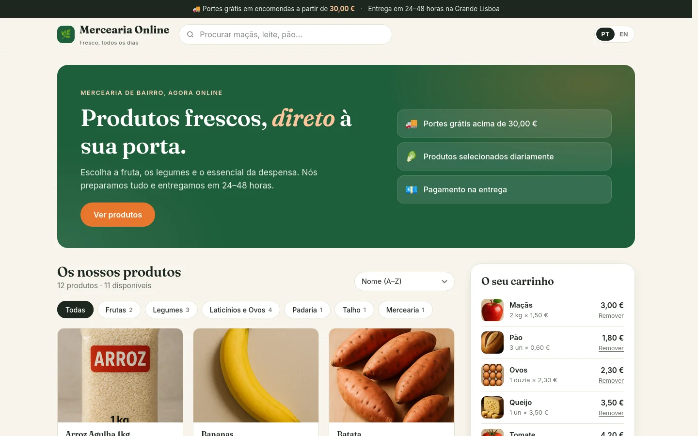
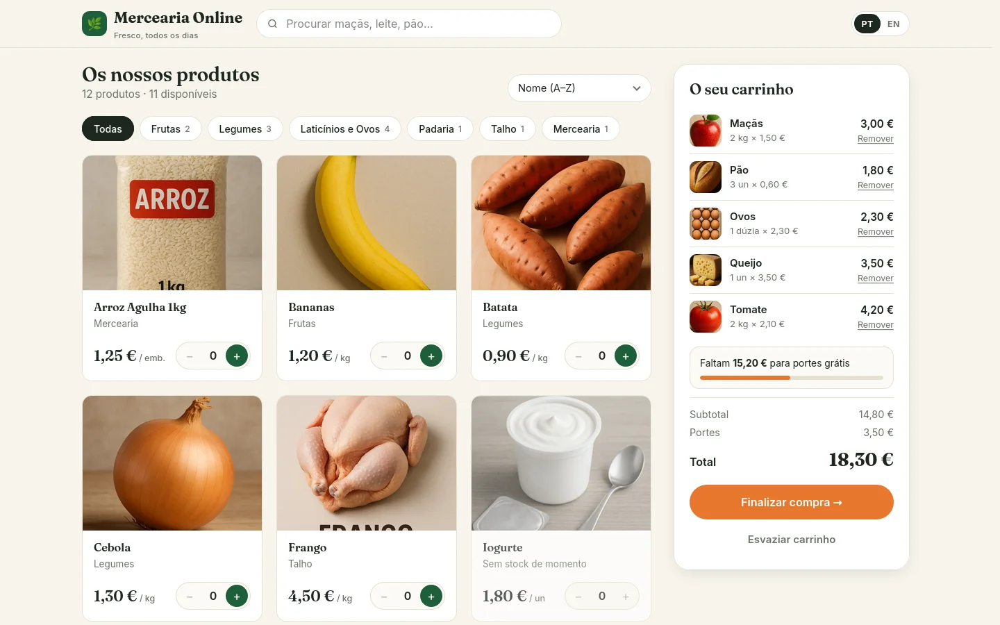
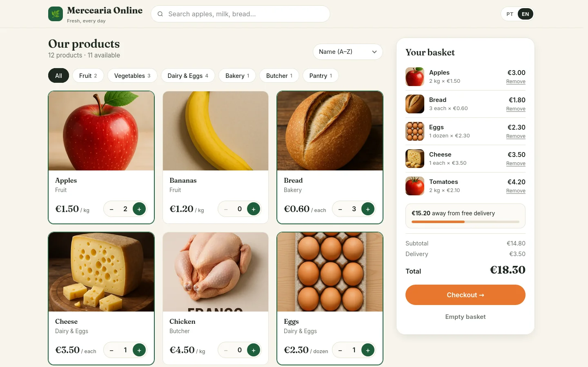
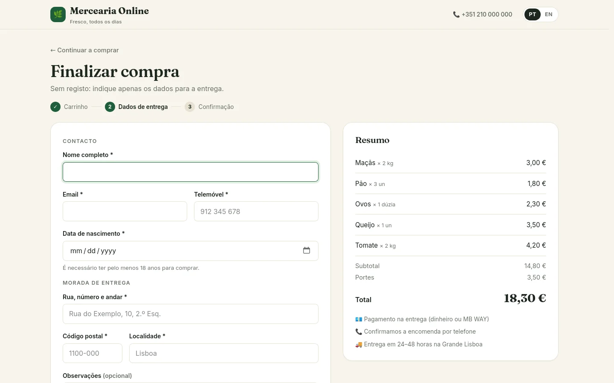
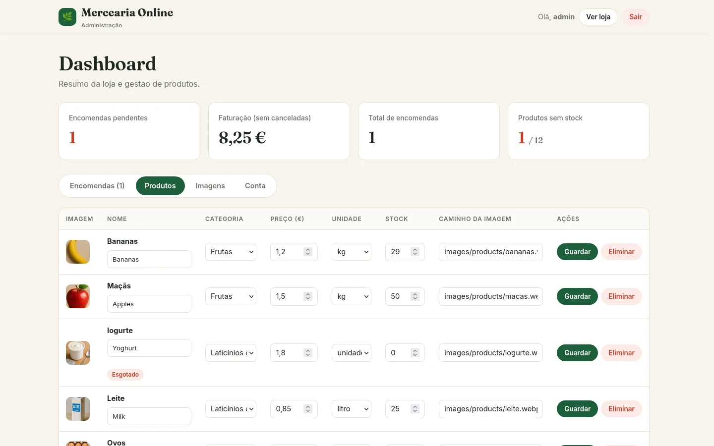
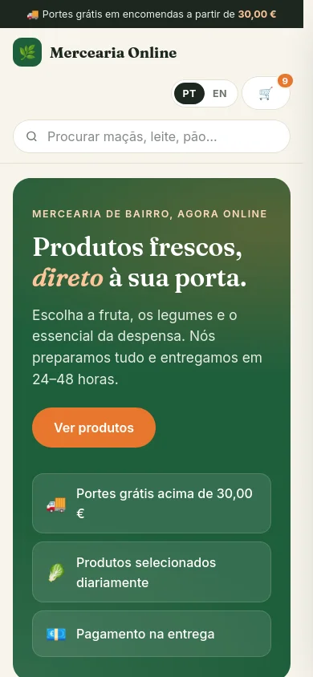

# 🌿 Mercearia Online

Loja online para uma mercearia de bairro: os clientes escolhem produtos, fazem a encomenda sem criar conta e pagam na entrega. A loja gere encomendas, stock e produtos num painel de administração.

Feito em **PHP 8, MySQL/MariaDB e JavaScript**, sem frameworks, com foco em segurança, acessibilidade e boa experiência no telemóvel. A loja está disponível em **português e inglês**.



| Loja com carrinho | Versão em inglês |
|---|---|
|  |  |
| **Checkout** | **Painel de administração** |
|  |  |

<p align="center">
  
  &nbsp;&nbsp;
  
</p>

---

## Funcionalidades

### Loja (cliente)
- Catálogo com **pesquisa**, **filtros por categoria** e **ordenação** (nome, preço, stock)
- Preço por unidade de venda (kg, litro, dúzia, unidade…) e avisos de **últimas unidades** / **esgotado**
- Carrinho que **persiste entre visitas**, com barra de progresso para **portes grátis** e aviso de **encomenda mínima**
- Checkout sem registo: contacto, morada com **código postal formatado automaticamente**, observações e aceitação dos termos
- Página de confirmação com **estado da encomenda** e comprovativo para imprimir
- Layout responsivo: carrinho lateral no computador, gaveta no telemóvel
- Esvaziar ou remover do carrinho com **"Desfazer"** (sem janelas de confirmação)
- **Bilingue PT / EN**: seletor de idioma, escolha guardada num cookie e deteção automática pelo idioma do browser; nomes de produtos, categorias, preços e mensagens do servidor traduzidos
- Termos e Condições, Política de Privacidade (RGPD), Livro de Reclamações e página 404

### Administração
- Painel com encomendas pendentes, faturação e produtos sem stock
- **Gestão de encomendas**: filtros por estado e fluxo _pendente → confirmada → em entrega → entregue_; **cancelar devolve o stock automaticamente**
- Gestão de produtos: nome em inglês, categoria, preço, unidade, stock e imagem (upload convertido automaticamente para WebP)
- Alteração da palavra-passe e registo de atividade (log)

### Segurança e proteção contra abusos
| Proteção | Como |
|---|---|
| SQL injection | Prepared statements (PDO) em todas as consultas |
| XSS | Escape na saída (`e()` / `textContent`) + Content-Security-Policy |
| CSRF | Token por sessão em todas as ações de admin; cookie `SameSite=Lax` |
| Força bruta no login | Bloqueio após 5 tentativas falhadas em 15 min por IP |
| Sessões | `HttpOnly`, ID regenerado no login, expiração após 30 min de inatividade |
| Encomendas falsas | Limite por IP/hora e por email, honeypot anti-bot, tempo mínimo de preenchimento, limites de quantidade e valor |
| Stock | Transações com desconto atómico (`quantity >= ?`) — sem stock negativo em compras simultâneas |
| Uploads | Tipo validado pelo conteúdo real, nome aleatório, execução de PHP bloqueada na pasta |
| Privacidade | O comprovativo só é visível na sessão de quem encomendou; o IP é guardado apenas como hash |
| Ficheiros sensíveis | `.htaccess` (Apache) e `router.php` (servidor do PHP) bloqueiam config, logs e `.sql` |
| Credenciais | Fora do código, em `config/config.local.php` (não vai para o Git) ou variáveis de ambiente |

Os preços, portes e totais são **sempre recalculados no servidor**: o cliente não consegue alterar valores pelo browser.

---

## Tecnologias

- **Backend:** PHP 8 (PDO), MySQL / MariaDB
- **Frontend:** HTML5, CSS3 (custom properties, grid, flexbox), JavaScript (ES2020, Fetch API)
- **Sem dependências:** nenhum framework nem pacote externo, só as fontes do Google Fonts
- **Imagens em WebP:** as fotos dos produtos ocupam ~380 KB no total

## Estrutura

```
├── index.php              Loja
├── pages/                 Checkout, confirmação, páginas legais, 404
├── admin/                 Login, dashboard, logout
├── api/                   Endpoints JSON (produtos, carrinho, encomendas, conta, upload)
├── includes/
│   ├── functions.php      Lógica de negócio e segurança
│   ├── layout.php         Cabeçalho e rodapé partilhados
│   ├── i18n.php           Sistema de idiomas (t(), deteção do idioma)
│   ├── lang/              Traduções pt.php e en.php
│   └── legal/             Termos e privacidade em PT e EN
├── config/
│   ├── database.php       Ligação à base de dados
│   ├── config.local.example.php  Modelo das credenciais (copiar para config.local.php)
│   └── store.php          Dados da loja, portes e limites (editável pelo cliente)
├── css/ js/ images/
├── docs/screenshots/      Capturas de ecrã do README
├── database.sql           Esquema completo + dados iniciais
├── migracao_v*.sql        Migrações para bases de dados antigas (v2 → v5)
└── router.php             Router para o servidor de desenvolvimento do PHP
```

---

## Instalação (Linux)

```bash
sudo apt install php-cli php-mysql php-gd php-mbstring mariadb-server
sudo systemctl enable --now mariadb

# Base de dados e utilizador
sudo mariadb < database.sql
sudo mariadb -e "CREATE USER 'mercearia'@'localhost' IDENTIFIED BY 'mude-esta-password';
                 GRANT ALL PRIVILEGES ON mercearia_online.* TO 'mercearia'@'localhost';"
```

Crie o ficheiro de credenciais a partir do modelo e indique lá o utilizador e a password:

```bash
cp config/config.local.example.php config/config.local.php
```

Em alternativa, defina as variáveis de ambiente `DB_HOST`, `DB_NAME`, `DB_USER` e `DB_PASS` (útil em alojamento). Depois arranque o servidor (o `-d` permite enviar fotos até 5 MB no painel; o PHP vem com 2 MB por omissão):

```bash
php -d upload_max_filesize=5M -S localhost:8000 router.php
```

Abra **http://localhost:8000**.

O painel de administração não tem link na loja (como numa loja real), mas está sempre em
**http://localhost:8000/admin/login.php**. Quem não souber o endereço não o encontra pela navegação.

> ⚠️ O utilizador inicial é `admin` / `123456`. **Mude a palavra-passe no separador "Conta"** logo no primeiro acesso.

Com **Apache / XAMPP**, basta copiar a pasta para `htdocs`: o `.htaccess` já trata da segurança e da página 404.

## Configuração da loja

Tudo o que muda de cliente para cliente está em [`config/store.php`](config/store.php): nome, contactos, NIF, horário, zona de entrega, portes, portes grátis, encomenda mínima, limites anti-abuso, categorias e unidades. Os textos com versão `_EN` são os usados em inglês.

### Idiomas

- Textos da interface: [`includes/lang/pt.php`](includes/lang/pt.php) e [`includes/lang/en.php`](includes/lang/en.php). Uma chave em falta no inglês usa o português.
- Nomes dos produtos em inglês: campo **"Nome em inglês"** no painel (coluna `name_en`). Sem tradução, mostra o nome em português.
- Para acrescentar um idioma: criar `includes/lang/xx.php`, juntá-lo a `SUPPORTED_LANGS` em `includes/i18n.php` e criar `includes/legal/*.xx.php`.
- O painel de administração é só em português (é a ferramenta interna da loja).

---

## Próximos passos

- [ ] Email de confirmação ao cliente e de aviso à loja
- [ ] Pagamento online (MB WAY / Multibanco / cartão)
- [ ] Testes automatizados

## Autor

Desenvolvido por **Guilherme** — projeto de portfólio.

## Licença

[MIT](LICENSE)
